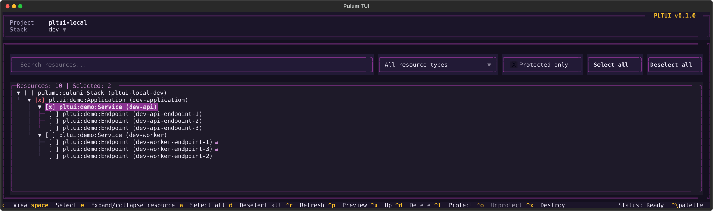

<h1 align="center">PLTUI</h1>

<p align="center">
  A terminal UI to explore and operate on your Pulumi stacks.<br>
  Built with <a href="https://textual.textualize.io">Textual</a> and the Pulumi Automation API.
</p>

<p align="center">
  
</p>

## Features

- **State explorer**: browse a stack's resources as a parent/child tree.
- **Search and filters**: live search (type, name, URN, ID, parent URN), a resource-type dropdown and a "Protected only" checkbox, all on one row.
- **Multi-selection**: select resources with the keyboard, or use filter-aware **Select all** / **Deselect all**.
- **Resource details**: overview, inputs, outputs and a diff of both, in a modal.
- **Pulumi actions**: preview, up, refresh and destroy, on the selected resources or the whole stack.
- **Safe by design**: up, refresh and destroy show a preview first and apply only after confirmation. If the stack state changes while you review, apply is blocked.
- **State editing**: delete resources from the state, or protect and unprotect them (🔒 marks protected resources).
- **Pulumi-branded dark theme** built on the three colours of the Pulumi logo.

## Install

### Requirements

- Python 3.11 or newer
- The [Pulumi CLI](https://www.pulumi.com/docs/iac/download-install/)

### As a command (recommended)

Install `pltui` as a standalone command in its own isolated environment, using [pipx](https://pipx.pypa.io) or [uv](https://docs.astral.sh/uv/):

```bash
pipx install git+https://github.com/SharpEdgeMarshall/pulumi-tui.git
# or
uv tool install git+https://github.com/SharpEdgeMarshall/pulumi-tui.git
```

Upgrade with `pipx upgrade pltui` or `uv tool upgrade pltui`. To try it without installing, run `uvx --from git+https://github.com/SharpEdgeMarshall/pulumi-tui.git pltui`.

### From source

Requires [Poetry](https://python-poetry.org/docs/#installation).

```bash
git clone https://github.com/SharpEdgeMarshall/pulumi-tui.git
cd pulumi-tui
poetry install
```

## Usage

Run `pltui` from a Pulumi project directory, or point it at one:

```bash
cd path/to/your/pulumi-project
pltui

# or
PLTUI_PROJECT_DIR=path/to/your/pulumi-project pltui
```

When running from a source checkout, prefix the command with `poetry run`.

Choose a stack with the dropdown in the header, then explore its resources.

| Variable | Description |
|---|---|
| `PLTUI_PROJECT_DIR` | Pulumi project directory to load. Defaults to the current directory. |


### Keybindings

**Actions**

| Key | Action |
|---|---|
| `Ctrl+P` | `pulumi preview` |
| `Ctrl+U` | `pulumi up` |
| `Ctrl+R` | `pulumi refresh` |
| `Ctrl+X` | `pulumi destroy` |
| `Ctrl+D` | Delete the selected resources from the state only (`pulumi state delete`) |
| `Ctrl+L` | Protect the selected resources. Needs at least one unprotected resource selected. |
| `Ctrl+O` | Unprotect the selected resources. Needs at least one protected resource selected. |
| `Ctrl+\` | Command palette |
| `Ctrl+Q` | Quit |

**Resource tree**

| Key | Action |
|---|---|
| `Space` | Select or deselect the focused resource |
| `A` / `D` | Select all / deselect all resources matching the filters |
| `E` | Expand or collapse the focused branch |
| `Enter` or double-click | Open the resource details |

**Modals**

| Key | Action |
|---|---|
| `Y` | Confirm |
| `T` | Toggle "Target dependents" |
| `A` / `R` | Apply / re-preview |
| `Esc` | Cancel or close |


### How actions work

- Preview, up, refresh and destroy target the selected resources, or the whole stack when nothing is selected.
- Up, refresh and destroy preview first and apply only after you confirm. Output streams live in a modal.
- The stack can't be locked, so PLTUI fingerprints the state before the preview and blocks apply if it changed.
- State delete, protect and unprotect need a selection, ask for confirmation and have no preview.
- The state reloads after every successful mutating action.

> Protecting a resource edits the stack state only. Unless your program also sets the `protect` resource option, the next `pulumi up` resets it.

### Resource selection

Select all and Deselect all affect only resources matching the current filters, including matches in collapsed branches. Parents shown only for context are not selected. Selections hidden by filters stay selected and are counted in the title.

Selection survives reloads of the same stack, dropping resources that no longer exist, and is cleared when a different stack is loaded.

## Try it locally

`examples/local` is a real Pulumi Python project on a local filesystem backend. It creates only component resources, so no cloud credentials, providers or billable infrastructure are needed.

```bash
poetry install
mkdir -p examples/local/.pulumi-state
export PULUMI_CONFIG_PASSPHRASE=''
poetry run pulumi -C examples/local stack init dev
poetry run pulumi -C examples/local up --yes
poetry run pulumi -C examples/local stack init sandbox
poetry run pulumi -C examples/local up --yes
PLTUI_PROJECT_DIR="$PWD/examples/local" poetry run pltui
```

The empty passphrase is only for this non-sensitive example. Backend files and stack configuration are ignored by Git. Run `stack init` once per stack; afterwards use `stack select dev` or `stack select sandbox` before `up`.

## Contributing

Contributions are welcome.

1. Fork the repository and create a branch.
2. Install dependencies with `poetry install`.
3. Use the local example project above as a test bench.
4. Make your change and open a pull request describing what and why.

### Project layout

| Path | Contents |
|---|---|
| `pltui/app.py` | App, key bindings and action flow |
| `pltui/service.py` | Pulumi Automation API and CLI wrapper |
| `pltui/models.py` | Pydantic models of the exported state |
| `pltui/selection.py` | Resource selection model |
| `pltui/components/` | Header, footer, state tree/inspector and modals |
| `pltui/theme.py`, `pltui/ui.tcss` | Themes and styling |
| `examples/local` | Local Pulumi project for development |

### Conventions

- Use Textual's standard semantic theme variables (such as `$primary`, `$error`, and `$background`) instead of hardcoded colours.
- Keep theme-specific styling in `pltui/theme.py`; avoid app-specific theme-variable aliases so built-in Textual themes remain compatible.
- Rely on Textual's `Footer` for key hints, and keep buttons and shortcuts consistent.
- Format with `ruff` and type-check with `mypy` (both are dev dependencies):

```bash
poetry run ruff check .
poetry run mypy pltui
```

### Refreshing the preview image

`docs/preview.svg` is a Textual screenshot, exported with `app.save_screenshot()` from a headless `run_test` session against `examples/local`.

## License

Apache-2.0. See [LICENSE](LICENSE).
