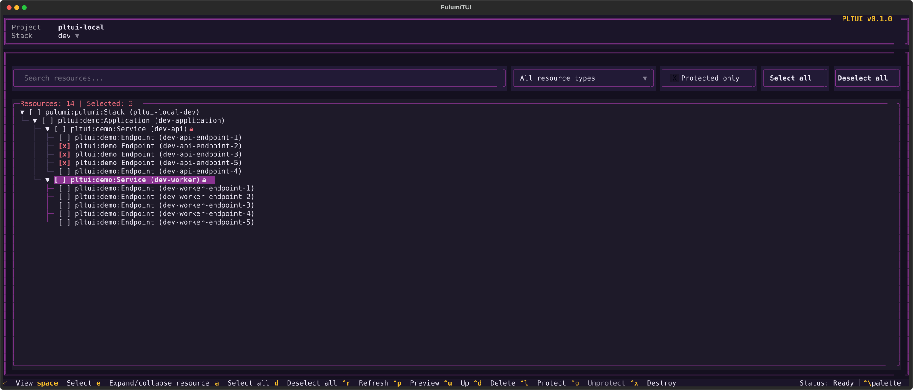
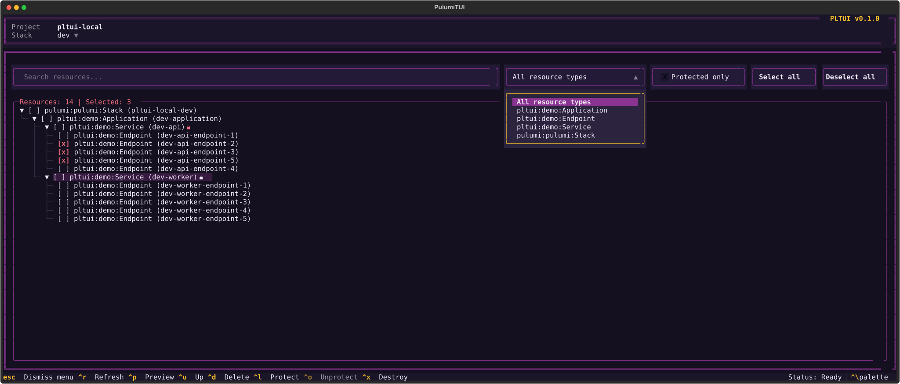
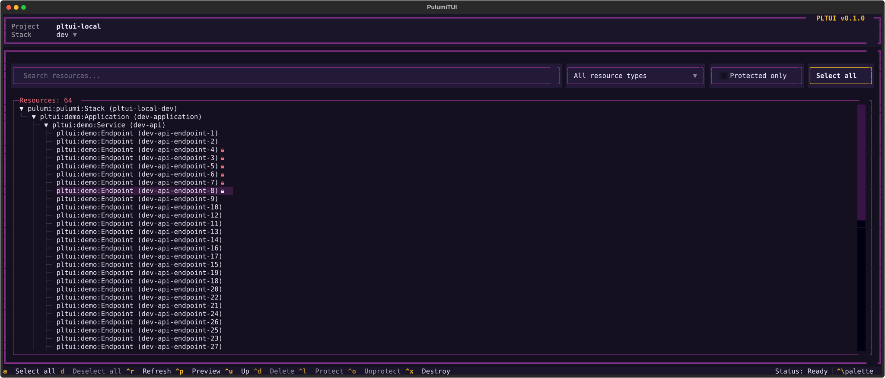
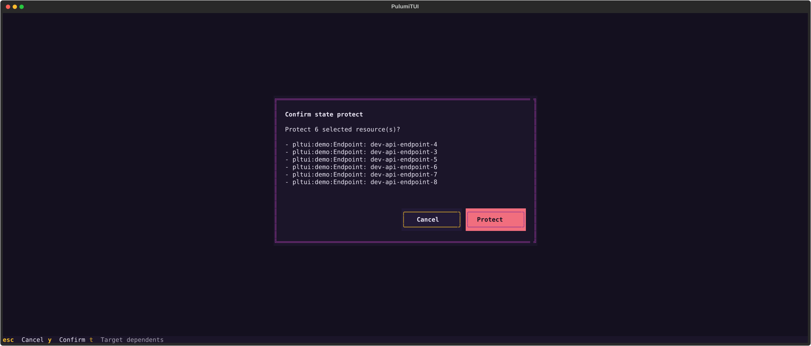
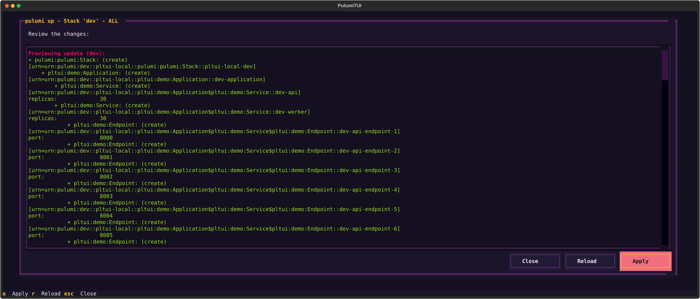
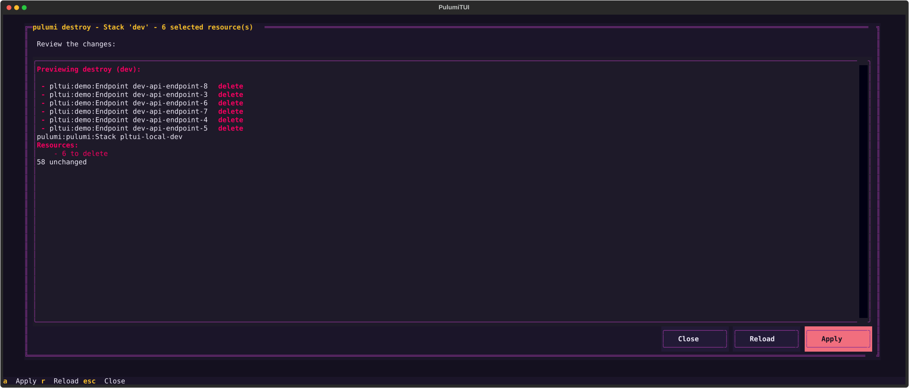
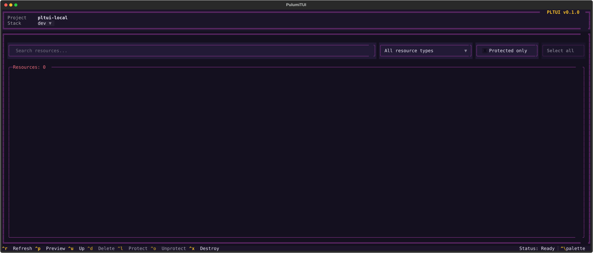

# Screenshots

A visual tour of PLTUI, captured against the [`examples/local`](../examples/local) project. See the [README](../README.md) for installation and usage.

## Browse the stack

The main view. The header shows the project and the stack selector. Below it are the search box, the resource type filter, the **Protected only** checkbox and the **Select all** / **Deselect all** buttons. The tree shows every resource with its parent/child hierarchy. The title counts the resources in the stack and how many are selected, and 🔒 marks protected resources.

## Filter by resource type

The type dropdown lists the resource types present in the stack. Combine it with the search box and **Protected only** to narrow the tree. **Select all** then affects only the resources that match the current filters, and selections hidden by a filter stay selected.

## Protected resources

A larger stack where several resources are protected. Protected resources carry a 🔒 and are guarded against deletion and destruction by Pulumi.

## Protect resources

Protecting or unprotecting resources edits the stack state, so PLTUI lists every affected resource and asks for confirmation first (`y` to confirm, `esc` to cancel, `t` to include dependents).

## Preview an update

`up`, `refresh` and `destroy` always show a preview first, as the Pulumi CLI would. Here `pulumi up` runs against the whole stack (`ALL`). Nothing is applied until you confirm, and apply is blocked if the stack state changes while you review.

## Destroy selected resources

When resources are selected, actions target only those resources. This preview destroys 6 selected resources and leaves the remaining 58 unchanged.

## Empty stack

A stack without resources, for example after a full destroy, is valid. The tree is empty and the title shows `Resources: 0`.
